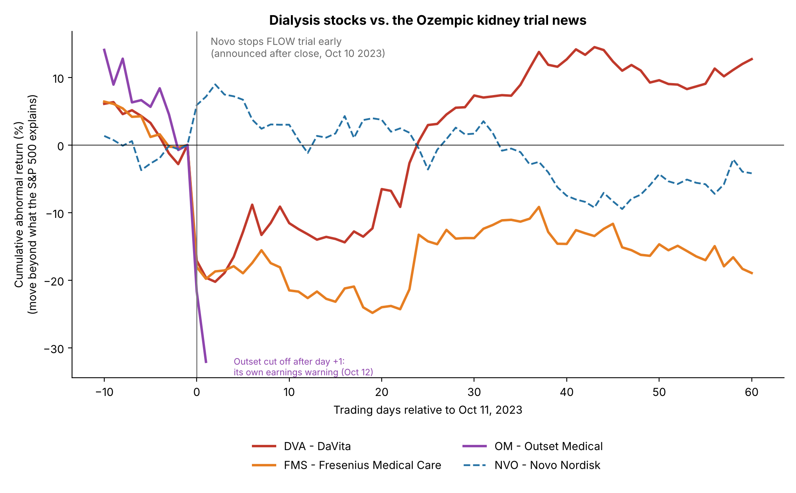
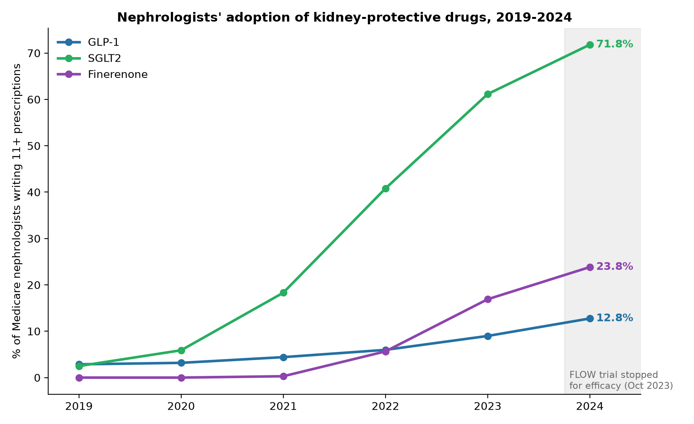
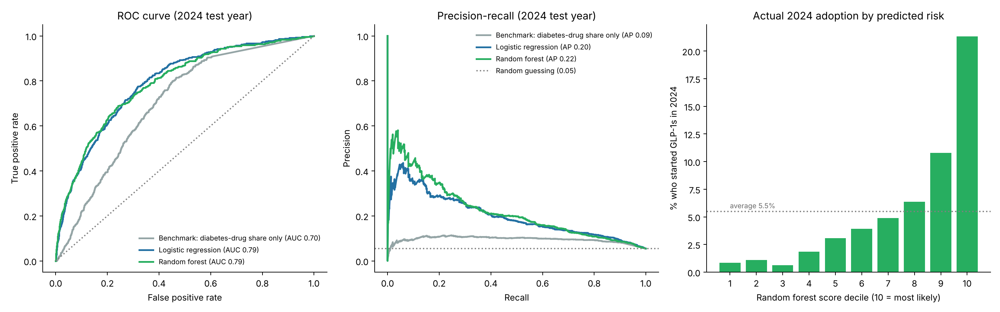
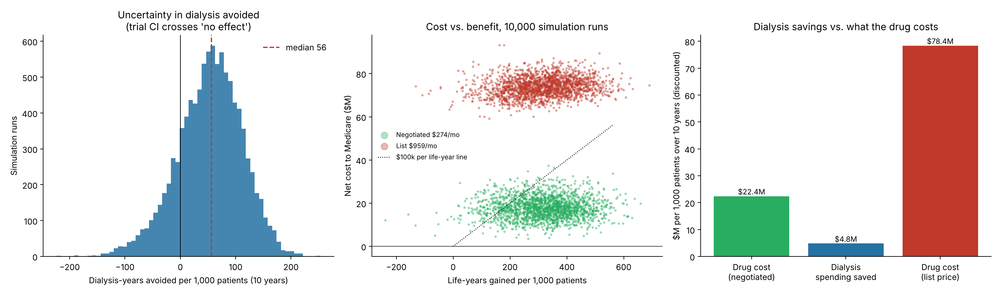

# Ozempic vs. Dialysis

What do GLP-1 drugs mean for kidney failure? A three-part analysis on public data:
how the market reacted, how nephrologists responded, and what the gap is worth.

## Findings

**1. Market signal.** When Novo Nordisk stopped its FLOW kidney trial early for efficacy
(announced after the close on Oct 10, 2023), DaVita fell 17.1% and Fresenius 18.0% beyond
what the market explains on the next trading day; Novo rose 5.9% (all |t| > 3).
The result holds under Fama-French market and 3-factor benchmarks. A second price feed
(Tiingo) gives identical daily returns, which confirms the price data but is not
independent evidence for the effect.



**2. Prescribing gap.** By 2024, 71.8% of Medicare nephrologists prescribed SGLT2 inhibitors
but only 12.8% prescribed GLP-1s. A model trained on 2023 adopters predicted 2024 adopters
with AUC 0.79 (3.9x lift in the top decile). Each standard deviation of dialysis-drug share
cut the odds of starting by about 40% (odds ratio 0.59, 95% CI 0.47-0.75).




**3. Value.** A Markov cohort model with Monte Carlo uncertainty (10,000 draws) puts
semaglutide at about $55,000 per discounted life-year over 10 years at Medicare's negotiated
price ($274/month, effective 2027), versus about $230,000 at the 2024 list price ($959/month).
Dialysis savings cover roughly a fifth of the drug's cost. These are model outputs: they
depend on the published inputs and on the stated assumptions below.



## Repository

| Script | Part | What it does |
| --- | --- | --- |
| `event_study.py` | 1 | Market-model event study (downloads prices via `yfinance`) |
| `robustness.py` | 1 | Tiingo price cross-check; Fama-French market and 3-factor benchmarks |
| `pull_prescriptions.py` | 2 | Downloads CMS Part D prescriptions by nephrologists, 2019-2024 |
| `adoption_summary.py` | 2 | Adoption trends by drug class, drug and state |
| `pull_providers.py` | 2 | Downloads CMS per-prescriber summary files, 2022-2024 |
| `model.py` | 2 | Logistic regression and random forest, validated forward in time |
| `simulate.py` | 3 | Cost-effectiveness simulation from published inputs |

Results are in `output/`. Raw data is not committed; the scripts re-download it.

## What's pulled, what's hand-entered, what's assumed

| Kind | What | Where |
| --- | --- | --- |
| Pulled from APIs | CMS Part D prescriber files (2019-2024, full years); daily prices (Yahoo, Tiingo); Fama-French factors | `pull_*.py`, `event_study.py`, `robustness.py` |
| Hand-entered, cited | FLOW trial results, USRDS survival and cost, CMS negotiated and list prices; event dates (FLOW stop, Outset warning) | `INPUTS` in `simulate.py`; constants in `event_study.py` |
| Assumed (not published figures) | 3% discount rate; Beta(407, 593) width on dialysis survival; placebo follow-up derived from the primary-outcome rate; constant hazards; trial effect persists beyond 3.4 years; transplants costed as dialysis; no adjustment between 2022 dialysis costs and the 2027 drug price | `ASSUMPTIONS` in `simulate.py` |

Hand-entered values, checked against their sources:

| Value | Used | Source |
| --- | --- | --- |
| FLOW placebo arm: 410 primary events, 7.5 per 100 patient-years | Placebo follow-up time | Perkovic et al., *NEJM* 2024;391:109-121 |
| FLOW placebo: 100 kidney-replacement starts (chronic dialysis or transplant); HR 0.84 (0.63-1.12) | Dialysis start rate and effect | FLOW (component outcome) |
| FLOW placebo: 279 deaths; HR 0.80 (0.67-0.95) | Death rate and effect | FLOW |
| 40.7% adjusted 5-year survival after starting hemodialysis (2018 cohort) | Death rate on dialysis | USRDS 2024 ADR, ESRD ch. 6, Fig. 6.8 |
| $99,369 Medicare FFS spending per person per year, in-center hemodialysis, 2022 | Dialysis cost | USRDS 2024 ADR, ESRD ch. 9, Fig. 9.11a |
| $274 per 30-day supply (effective Jan 1, 2027) vs $959 2024 list price | Drug cost | CMS negotiated prices, announced Nov 2025 |
| Novo announced the FLOW stop after the US close on Oct 10, 2023 (release timestamped 20:37 UTC) | Event day = Oct 11, 2023 | Novo Nordisk company announcement |
| Outset Medical preannounced weak Q3 2023 results after the close on Oct 12, 2023 | Outset excluded from day +2 | Outset Medical press release (Business Wire) |

## Reproduce

```
python3 -m venv .venv && source .venv/bin/activate
pip install -r requirements.txt
python event_study.py
export TIINGO_API_KEY="your_key"   # free at tiingo.com
python robustness.py
python pull_prescriptions.py && python adoption_summary.py
python pull_providers.py && python model.py
python simulate.py
```

## Data sources

- Centers for Medicare & Medicaid Services, *Medicare Part D Prescribers - by Provider and Drug* and *by Provider*, 2019-2024, data.cms.gov.
- Daily adjusted prices: Yahoo Finance (`yfinance`), cross-checked with Tiingo.
- Kenneth French Data Library, Fama-French 3 factors (daily).
- Perkovic et al., "Effects of Semaglutide on Chronic Kidney Disease in Patients with Type 2 Diabetes," *NEJM* 2024 (FLOW).
- United States Renal Data System, *2024 Annual Data Report*, ESRD ch. 6 (Fig. 6.8) and ch. 9 (Fig. 9.11a): https://usrds-adr.niddk.nih.gov/2024
- CMS negotiated Medicare prices for 2027 (announced Nov 2025): $274 per 30-day supply for semaglutide vs a $959 2024 list price.
- Novo Nordisk company announcement, Oct 10, 2023 (FLOW stopped early for efficacy).
- Outset Medical, "Outset Medical Reports Preliminary Third Quarter 2023 Financial Results," Oct 12, 2023.

## Limitations

- CMS hides doctor-drug pairs with fewer than 11 claims, so adoption is understated (equally across drug classes).
- Medicare only; GLP-1s may be prescribed by a patient's other doctors.
- FLOW's kidney-replacement hazard ratio (chronic dialysis or transplant) has a 95% CI that crosses 1; the simulation samples that uncertainty.
- Placebo follow-up is derived from the primary-outcome rate (time to first event), which is shorter than total follow-up, so the model's baseline dialysis and death rates are somewhat high.
- The 10-year horizon extrapolates beyond the 3.4-year trial (trial-length result: ~$173,000 per life-year).
- The cost model omits cardiovascular savings (understating value) and other costs of longer survival (overstating it).
